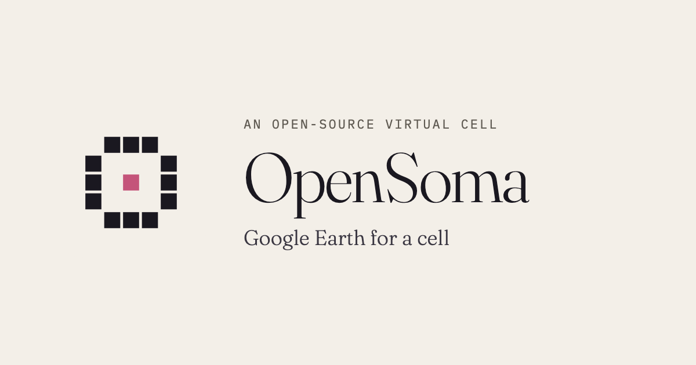

<p align="center"></p>

# OpenSoma

**Google Earth for a cell.** An open-source, browser-based virtual cell: zoom in, switch off a gene or add a drug, and see what happens. An educational tool for cancer biology and drug discovery.

**Live site: [ryanjmahn.github.io/opensoma](https://ryanjmahn.github.io/opensoma/)**

> Educational simulation of cells grown in a lab. **Not medical advice.**

## What you can do

- **Explore**: fly from a 3D cell down to organelles, pathways, genes and 3D molecules. Hover to highlight, toggle layers, take a tour, and switch genes off in place.
- **Playground**: switch off genes or add drugs to a cancer cell (K562) and a healthy-like cell (RPE1), with a plain-language verdict on which cell is hit harder.
- **Compare**: put two genes or drugs head to head.
- **Learn**: 6 guided tours on cancer biology and 4 lessons on drug discovery, with quizzes.
- **Missions**: find a target, calm the cell down, do no harm to healthy cells, and beat resistance.
- **Molecules**: real protein structures with drugs bound in their pockets.
- **For teachers**: shareable lesson links and printable worksheets.

Every result says whether it was **measured** in a real experiment or **predicted** by the model, with an honest confidence level.

## The data

All measured results come from genome-scale CRISPRi Perturb-seq experiments (Replogle et al., *Cell* 2022, CC BY 4.0). Pathways come from Reactome, gene descriptions from UniProt, and structures from the RCSB PDB and AlphaFold. See [How it works](https://ryanjmahn.github.io/opensoma/#/how) for what the model does and where it falls short.

## Repo layout

| Folder | What's in it |
|---|---|
| `pipeline/` | Python: download raw data, process it, predict, and export static JSON |
| `web/` | The website (Vite, React, TypeScript, Tailwind, three.js, 3Dmol.js) |
| `web/public/data/` | Generated data files the site loads (small, committed) |
| `content/` | Lessons, tours, missions, drugs, network and sources: edit these without touching code |
| `data/SCHEMA.md` | Data format, so other apps (for example a Swift app) can read the same files |
| `tests/` | Pipeline tests (web tests live next to the code in `web/src`) |

## Run the website locally

```bash
cd web
npm install
npm run dev      # http://localhost:5173
npm test && npm run lint
```

## Rebuild the data (optional, about 600 MB download)

```bash
python3 -m venv .venv && .venv/bin/pip install -r pipeline/requirements.txt
.venv/bin/python pipeline/download.py     # raw data into data/raw/ (gitignored)
.venv/bin/python pipeline/export.py       # web/public/data/*.json and content/sources.md
.venv/bin/python pipeline/export_ssc.py   # data/ssc-slice.zip (offline bundle)
.venv/bin/pytest tests
```

## Deploy

Every push to `main` deploys to GitHub Pages through `.github/workflows/deploy.yml`. One-time setup: repo **Settings → Pages → Source: GitHub Actions**.

## Credits and license

Data and software credits: [CREDITS.md](CREDITS.md). Scientific sources: [content/sources.md](content/sources.md). Code license: TBD.
